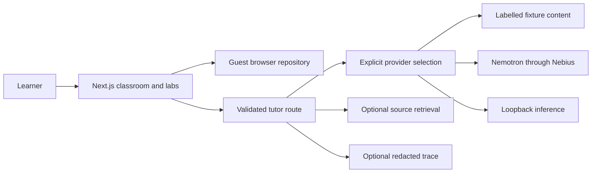

# Architecture

Next.js App Router serves pages and `/api/tutor` and `/api/status`. Client components handle forms, interactive SVG, fixed Python traces, charts, and guest storage. A typed repository interface isolates browser persistence. Server-side Zod validates requests and model lessons. The provider factory selects fixture, Nebius, or local adapters explicitly.

The server never persists learner records in this version. No shared student database exists to expose other learners' records. SQL migration 001 defines learner-owned production tables with RLS, but deployment/application of that schema and its authenticated repository remain pending. Never use browser scores as authoritative production achievements.

Request budget: one model generation per tutoring action; at most one retry on transient network/service failure, 1600 output tokens, 200-character topic, 2000-character learner message, up to four source excerpts. Requests time out after 15 seconds per attempt. Local maps bound cache entries, but distributed deployments require a shared rate limiter/cache before production traffic.
