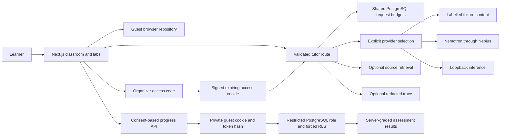

# Architecture

Next.js App Router serves ten pages and tutor, structured workflow, access, progress, and status APIs. Client components keep the original browser guest repository and offer optional hosted synchronization. Zod validates requests, model outputs, preferences, and assessment answers. Explicit fixture/Nebius/local selection never silently falls back.

Production guest persistence is implemented but opt-in and unverified on a hosted service. Migration 002 defines guest profiles/results and shared request buckets in a private schema. Every repository operation uses one database client and transaction, sets a transaction-local hashed guest capability, and lets forced RLS isolate rows. Superuser, RLS-bypass, and table-owner runtime roles are rejected. Client-provided scores/learner IDs are never accepted; the server grades known question sets. The old named-account design is retained under db/proposals. Named accounts/recovery are not implemented.

Request budget: one model generation/action, at most one transient retry, 1600 output tokens, 200-character topic, 2000-character message, four bounded history excerpts and four sources. Per-attempt external timeout is 15 seconds. Production live requests require PostgreSQL quotas: 12 total actions/minute and 6/access cookie/minute. Organizer unlock attempts cap at 30/minute; progress requests at 120/minute. Public fixtures keep local request limits. Educational source caching is bounded/process-local with in-flight deduplication; multi-instance cache hits are not guaranteed. LangSmith receives redacted text plus actual usage, duration/errors, and aggregate rubric metrics; serverless routes flush the shared client after completion.
