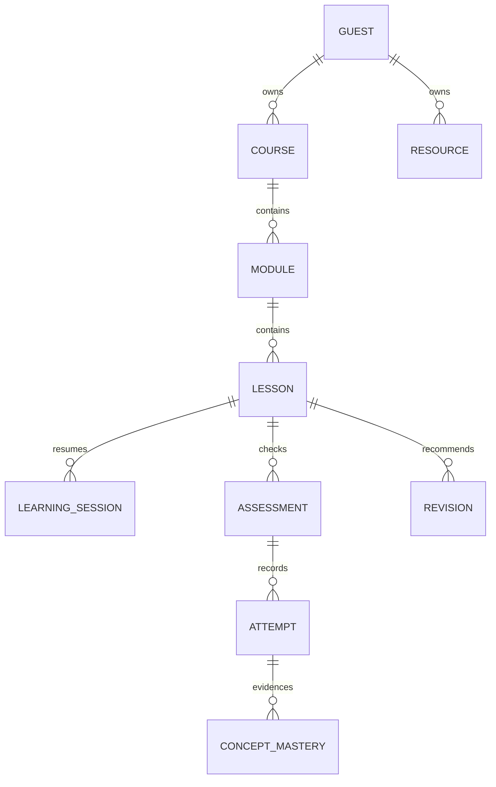

# Database schema

Apply 002 then 003 once as the migration administrator. Runtime must inherit neurolearn_app without superuser, ownership or RLS bypass. No hosted migration was executed.

Final readiness smoke adds cross-guest overwrite checks that require SQLSTATE 42501, followed by owned-library readback and cascading deletion checks. Connection errors cannot count as permission-isolation success. Actual hosted execution remains BLOCKED by missing DATABASE_URL; embedded tests are the current evidence. See DEPLOYMENT_READINESS.md for restricted-login/TLS setup and manual verification.

| Table | Relationship / meaning |
| --- | --- |
| guests | Hashed private guest capability/preferences, no account identity |
| activities | Existing server-graded curated checks |
| courses | Owned outline/snapshot; ten-course limit |
| modules | Ordered course + owner composite FK |
| lessons | Module + owner composite FK and validated snapshot |
| learning_sessions | Lesson + owner FK, state and 0–2 retries |
| assessments | Lesson-linked curated or AI-generated-unreviewed questions |
| attempts | Assessment + owner FK, submitted answers/recomputed scores |
| concept_mastery | Attempt evidence, needs-review/passed-check, not broad mastery |
| resources | Private extracted pages/bounded metadata; no original binaries |
| revisions | Lesson-linked concept, suggested one-day review after mistake |
| request_buckets | Private shared quotas through bounded function |

All learner tables enforce RLS via transaction-local guest hash. Composite owner FKs prevent cross-owner parent/evidence records. Guest deletion cascades. Snapshots validate answer-derived scores/gaps and state replay; curated keys match the server bank. Generated keys remain unreviewed and histories are not tamper-proof examinations.

Library GET loads courses/notes; POST saves one; DELETE removes an owned note. Production uses organizer access/shared quotas, 500,000-byte writes, ten courses/five notes. Course save atomically replaces normalized children; manual load replaces same-ID local copies. Concurrent versioned merging, accounts and retention operations are outstanding.

Embedded tests execute real SQL/repository writes, repeat saves, attempts/revisions, cross-guest rejection and deletion. Hosted TLS, load, backups/recovery and retention remain unverified. Losing guest cookie loses access.

